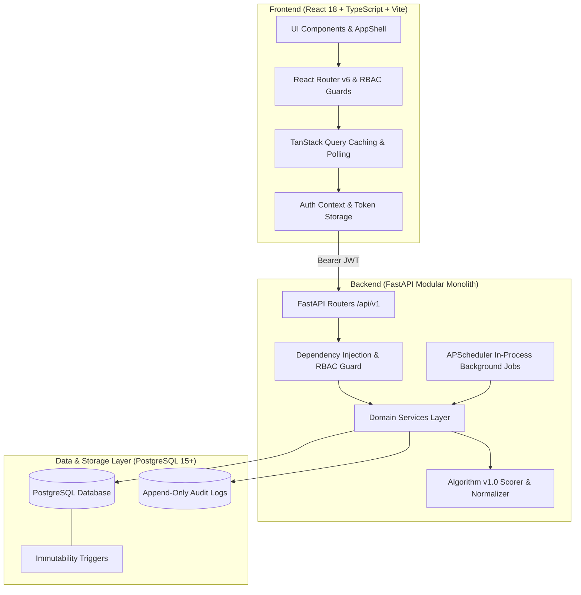
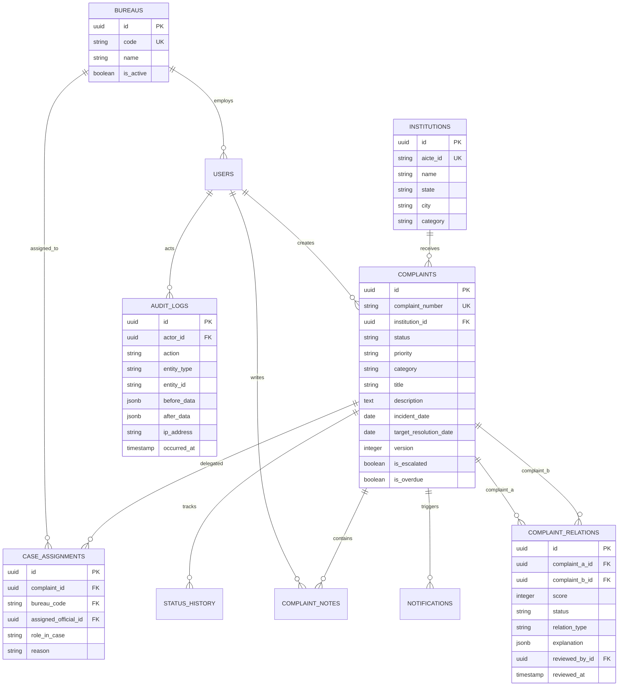
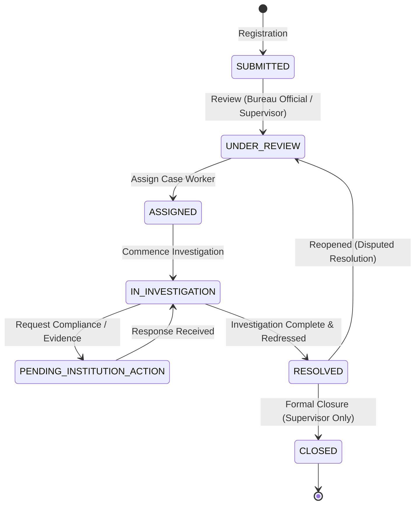
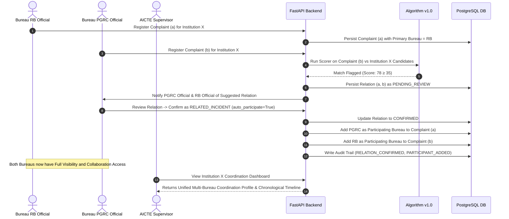
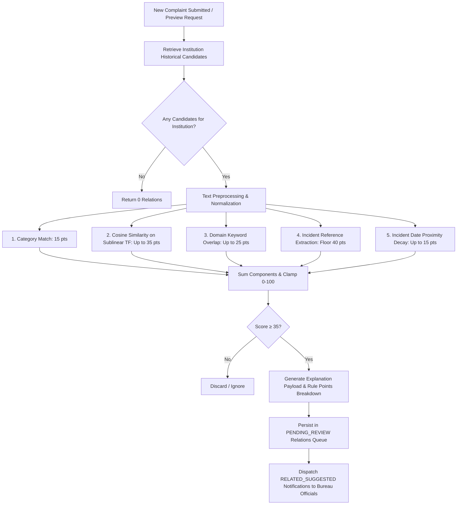

# System Architecture & Design (ARCHITECTURE.md)

This document provides architectural diagrams, domain models, lifecycle states, and algorithmic workflows for the **AICTE Integrated Institution Complaint Monitoring and Status Dashboard**.

---

## 1. High-Level System Architecture

---

## 2. Entity-Relationship (ER) Data Model

---

## 3. Complaint Lifecycle State Transitions

---

## 4. Cross-Bureau Coordination Workflow

---

## 5. Duplicate Detection Algorithm v1.0 Pipeline

